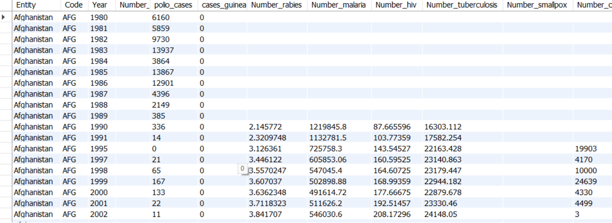
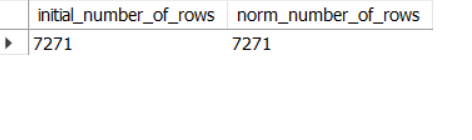
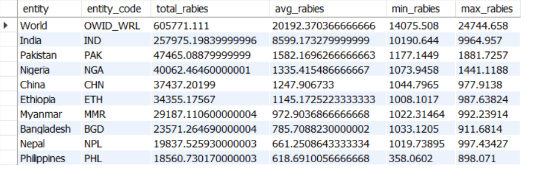
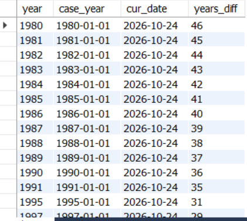
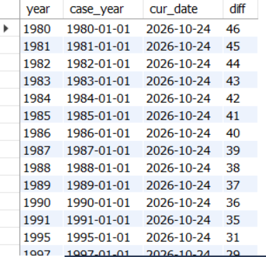
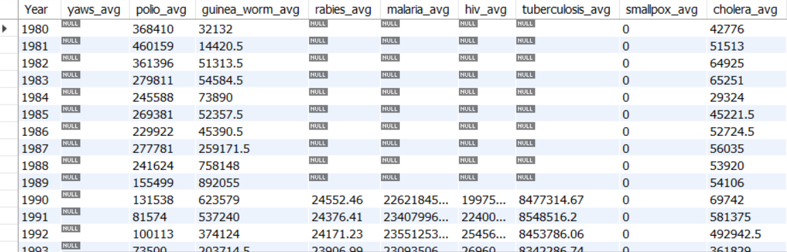

# Фінальний проєкт з реляційних баз даних (goit-rdb-fp)

## Опис проєкту

Цей репозиторій містить виконання фінального проєкту з нормалізації бази даних, агрегації показників захворюваності у світі та роботи з вбудованими й користувацькими SQL-функціями в системі керування базами даних MySQL.

Схема бази даних: `pandemic`

---

## Завдання 1. Створення схеми та імпорт даних

1. Створено схему `pandemic` за допомогою SQL-команди.
2. Встановлено її як схему за замовчуванням (`USE pandemic;`).
3. За допомогою майстра імпорту (Table Data Import Wizard) завантажено набір даних із [CSV-файлу](https://drive.google.com/file/d/1lHEXJvu2omYRgvSek6mHq-iQ3RmGAQ7e/view?usp=sharing) в таблицю `infectious_cases`. 
4. Перевірено коректність завантаження даних.

```sql
CREATE SCHEMA IF NOT EXISTS `pandemic`;
USE `pandemic`;

SELECT
    `Entity`,
    `Code`,
    `Year`,
    `Number_yaws`,
    `polio_cases`,
    `cases_guinea_worm`,
    `Number_rabies`,
    `Number_malaria`,
    `Number_hiv`,
    `Number_tuberculosis`,
    `Number_smallpox`,
    `Number_cholera_cases`
FROM `pandemic`.`infectious_cases`;
```

### Результат виконання:



---

## Завдання 2. Нормалізація даних до 3-ї нормальної форми (3NF)

Оригінальна таблиця `infectious_cases` містила повторювані текстові атрибути `Entity` та `Code`. Для усунення надлишковості та приведення структури до 3NF створено дві таблиці:

1. `entities` — довідник сутностей/країн (`entity_id`, `entity`, `entity_code`).
2. `infectious_cases_norm` — нормалізована таблиця фактів, що зберігає посилання `entity_id` як зовнішній ключ (`FOREIGN KEY`), рік спостереження та всі показники захворюваності.

```sql
CREATE TABLE IF NOT EXISTS entities (
    entity_id INT AUTO_INCREMENT PRIMARY KEY,
    entity VARCHAR(255) NOT NULL,
    entity_code VARCHAR(10)
);

INSERT INTO entities (entity, entity_code)
SELECT DISTINCT entity, code
FROM infectious_cases;

CREATE TABLE IF NOT EXISTS infectious_cases_norm LIKE infectious_cases;

ALTER TABLE infectious_cases_norm
    DROP COLUMN Entity,
    DROP COLUMN Code,
    ADD COLUMN case_id INT AUTO_INCREMENT PRIMARY KEY FIRST,
    ADD COLUMN entity_id INT NOT NULL AFTER case_id,
    ADD FOREIGN KEY (entity_id) REFERENCES entities(entity_id);

INSERT INTO infectious_cases_norm (
    entity_id,
    Year,
    Number_yaws,
    polio_cases,
    cases_guinea_worm,
    Number_rabies,
    Number_malaria,
    Number_hiv,
    Number_tuberculosis,
    Number_smallpox,
    Number_cholera_cases
)
SELECT
    e.entity_id,
    ic.Year,
    ic.Number_yaws,
    ic.polio_cases,
    ic.cases_guinea_worm,
    ic.Number_rabies,
    ic.Number_malaria,
    ic.Number_hiv,
    ic.Number_tuberculosis,
    ic.Number_smallpox,
    ic.Number_cholera_cases
FROM infectious_cases AS ic
JOIN entities AS e
    ON ic.entity = e.entity
    AND (ic.Code = e.entity_code OR (ic.Code IS NULL AND e.entity_code IS NULL));

-- Звірка кількості рядків в обох таблицях
SELECT
    (SELECT COUNT(*) FROM infectious_cases) AS initial_number_of_rows,
    (SELECT COUNT(*) FROM infectious_cases_norm) AS norm_number_of_rows;
```

### Результат виконання:



---

## Завдання 3. Аналіз даних: агрегація показників сказу (Number_rabies)

Для кожної унікальної сутності розраховано:

- Середнє значення (`AVG`)
- Мінімальне значення (`MIN`)
- Максимальне значення (`MAX`)
- Загальну суму випадків (`SUM`)

Попередньо відфільтровано порожні текстові значення та `NULL`. Результат відсортовано за спаданням середнього показника та обмежено топ-10 записами.

```sql
SELECT
    e.entity,
    e.entity_code,
    AVG(icn.Number_rabies) AS avg_rabies,
    MIN(icn.Number_rabies) AS min_rabies,
    MAX(icn.Number_rabies) AS max_rabies,
    SUM(icn.Number_rabies) AS total_rabies
FROM infectious_cases_norm AS icn
JOIN entities AS e ON icn.entity_id = e.entity_id
WHERE icn.Number_rabies != ''
  AND icn.Number_rabies IS NOT NULL
GROUP BY e.entity, e.entity_code
ORDER BY avg_rabies DESC
LIMIT 10;
```

### Результат виконання:



---

## Завдання 4. Побудова колонок дат та різниці в роках

Для нормалізованої таблиці побудовано:

1. Дату початку відповідного року (перше січня) за допомогою `MAKEDATE(Year, 1)`.
2. Поточну дату за допомогою `CURDATE()`.
3. Різницю в роках між поточною датою та 1 січня відповідного року за допомогою вбудованої функції `TIMESTAMPDIFF(YEAR, ...)`.

```sql
SELECT
    icn.Year,
    MAKEDATE(icn.Year, 1) AS case_year,
    CURDATE() AS cur_date,
    TIMESTAMPDIFF(YEAR, MAKEDATE(icn.Year, 1), CURDATE()) AS years_diff
FROM infectious_cases_norm AS icn;
```

### Результат виконання:



---

## Завдання 5. Створення власних SQL-функцій

### 5.1. Функція розрахунку різниці в роках (`Calc_diff`)

Функція приймає рік як параметр типу `INT` і повертає різницю у роках між поточною датою та датою 1 січня цього року. Оскільки результат залежить від моменту виконання (`CURDATE()`), вона позначена як `NOT DETERMINISTIC`.

```sql
DROP FUNCTION IF EXISTS Calc_diff;

DELIMITER //

CREATE FUNCTION Calc_diff(input_year INT)
RETURNS INT
NOT DETERMINISTIC
NO SQL
BEGIN
    DECLARE diff INT;
    SET diff = TIMESTAMPDIFF(YEAR, MAKEDATE(input_year, 1), CURDATE());
    RETURN diff;
END //

DELIMITER ;

SELECT
    icn.Year,
    MAKEDATE(icn.Year, 1) AS case_year,
    CURDATE() AS cur_date,
    Calc_diff(icn.Year) AS diff
FROM infectious_cases_norm AS icn;
```

#### Результат виконання:



---

### 5.2. Додаткова функція розрахунку захворювань за період (`Calc_disease_freq`)

Функція приймає річну кількість випадків та дільник періоду (2 — півріччя, 4 — квартал, 12 — місяць). Включає перевірку на коректність дільника та невід'ємність числових значень.

```sql
DROP FUNCTION IF EXISTS Calc_disease_freq;

DELIMITER //

CREATE FUNCTION Calc_disease_freq(
    input_quantity DOUBLE,
    input_period INT
)
RETURNS DOUBLE
DETERMINISTIC
NO SQL
BEGIN
    DECLARE freq DOUBLE;

    IF input_quantity IS NULL
       OR input_quantity < 0
       OR input_period NOT IN (2, 4, 12)
    THEN
        RETURN NULL;
    END IF;

    SET freq = input_quantity / input_period;
    RETURN ROUND(freq, 2);
END //

DELIMITER ;

SET @period = 12;

SELECT
    icn.Year,
    Calc_disease_freq(SUM(NULLIF(icn.Number_yaws, '')), @period) AS yaws_avg,
    Calc_disease_freq(SUM(NULLIF(icn.polio_cases, '')), @period) AS polio_avg,
    Calc_disease_freq(SUM(NULLIF(icn.cases_guinea_worm, '')), @period) AS guinea_worm_avg,
    Calc_disease_freq(SUM(NULLIF(icn.Number_rabies, '')), @period) AS rabies_avg,
    Calc_disease_freq(SUM(NULLIF(icn.Number_malaria, '')), @period) AS malaria_avg,
    Calc_disease_freq(SUM(NULLIF(icn.Number_hiv, '')), @period) AS hiv_avg,
    Calc_disease_freq(SUM(NULLIF(icn.Number_tuberculosis, '')), @period) AS tuberculosis_avg,
    Calc_disease_freq(SUM(NULLIF(icn.Number_smallpox, '')), @period) AS smallpox_avg,
    Calc_disease_freq(SUM(NULLIF(icn.Number_cholera_cases, '')), @period) AS cholera_avg
FROM infectious_cases_norm AS icn
GROUP BY icn.Year
ORDER BY icn.Year ASC;

SET @period = 4;

SELECT
    icn.Year,
    Calc_disease_freq(SUM(NULLIF(icn.Number_yaws, '')), @period) AS yaws_avg,
    Calc_disease_freq(SUM(NULLIF(icn.polio_cases, '')), @period) AS polio_avg,
    Calc_disease_freq(SUM(NULLIF(icn.cases_guinea_worm, '')), @period) AS guinea_worm_avg,
    Calc_disease_freq(SUM(NULLIF(icn.Number_rabies, '')), @period) AS rabies_avg,
    Calc_disease_freq(SUM(NULLIF(icn.Number_malaria, '')), @period) AS malaria_avg,
    Calc_disease_freq(SUM(NULLIF(icn.Number_hiv, '')), @period) AS hiv_avg,
    Calc_disease_freq(SUM(NULLIF(icn.Number_tuberculosis, '')), @period) AS tuberculosis_avg,
    Calc_disease_freq(SUM(NULLIF(icn.Number_smallpox, '')), @period) AS smallpox_avg,
    Calc_disease_freq(SUM(NULLIF(icn.Number_cholera_cases, '')), @period) AS cholera_avg
FROM infectious_cases_norm AS icn
GROUP BY icn.Year
ORDER BY icn.Year ASC;

SET @period = 2;

SELECT
    icn.Year,
    Calc_disease_freq(SUM(NULLIF(icn.Number_yaws, '')), @period) AS yaws_avg,
    Calc_disease_freq(SUM(NULLIF(icn.polio_cases, '')), @period) AS polio_avg,
    Calc_disease_freq(SUM(NULLIF(icn.cases_guinea_worm, '')), @period) AS guinea_worm_avg,
    Calc_disease_freq(SUM(NULLIF(icn.Number_rabies, '')), @period) AS rabies_avg,
    Calc_disease_freq(SUM(NULLIF(icn.Number_malaria, '')), @period) AS malaria_avg,
    Calc_disease_freq(SUM(NULLIF(icn.Number_hiv, '')), @period) AS hiv_avg,
    Calc_disease_freq(SUM(NULLIF(icn.Number_tuberculosis, '')), @period) AS tuberculosis_avg,
    Calc_disease_freq(SUM(NULLIF(icn.Number_smallpox, '')), @period) AS smallpox_avg,
    Calc_disease_freq(SUM(NULLIF(icn.Number_cholera_cases, '')), @period) AS cholera_avg
FROM infectious_cases_norm AS icn
GROUP BY icn.Year
ORDER BY icn.Year ASC;
```

#### Результат виконання (@period = 12):


